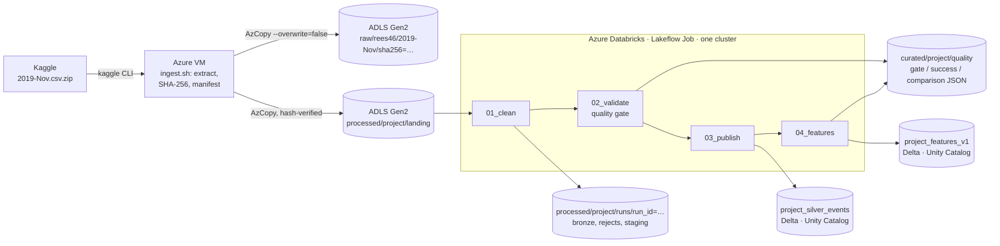

# Cart-to-purchase conversion on Azure — Phase 1: data pipeline, ETL and features

DSAI3202 Cloud Computing, Fall 2026 · Farid Abdul Rehman (60304642) · Instructor: Dr. Elyor Kodirov

## Project and hypothesis

- **Problem and user:** when a shopper adds a product to the cart, predict the probability that they buy that product in the same session. E-commerce marketing/CRM teams can target likely abandoners with offers and avoid discounting shoppers who would buy anyway.
- **Prediction target:** `purchased` (binary). One row per `(user_session, product_id)` at its first `cart` event; `purchased = 1` if a `purchase` of the same product follows in the same session.
- **Hypothesis (H1):** behavioural features of the current session and the shopper's earlier activity predict conversion better than a baseline that only knows how often the product is usually bought. XGBoost reaches a test ROC-AUC at least **0.05** above the baseline, the 95% bootstrap CI of the difference excludes zero, and the gain holds on each test day including Black Friday (29 Nov).
- **Baseline and metric:** each cart scored with the product's cart-to-purchase rate in the training period (category rate for unseen products); majority class and logistic regression reported for reference. Metrics: ROC-AUC and PR-AUC (imbalanced classes), F1/accuracy at a validation-chosen threshold.
- **Approved changes:** none to the topic, dataset or hypothesis. Clarification: Phase 0 mentioned the "October csv" once in the pipeline sketch; the dataset section and split use **November 2019 only**, which is what Phase 1 implements. Phase 0 planned "Parquet partitions"; Phase 1 uses Delta (Parquet files plus a transaction log) for atomic publishes and versioning.

## Dataset and architecture

- **Source:** [eCommerce behavior data from multi category store](https://www.kaggle.com/datasets/mkechinov/ecommerce-behavior-data-from-multi-category-store) (REES46 Open CDP, M. Kechinov). Free to use with credit to Kaggle and the REES46 Marketing Platform. File `2019-Nov.csv`: CSV, **9,006,762,395 bytes uncompressed** (2,874,125,107 bytes as the Kaggle zip), **67,501,979 events**.
- **Raw version and source receipt:** `raw/rees46/2019-Nov/sha256=addd9a27ed99/2019-Nov.csv`, SHA-256 `addd9a27ed99abdece368019ebfba19568972c7fcbe949db3484aab8a3bcffec`, downloaded 2026-11-14 11:26 UTC. Manifest: [`evidence/ingestion/source-manifest.json`](evidence/ingestion/source-manifest.json) (bytes, hash, row count, header, Kaggle listing, transport-archive hash). The folder name is derived from the content hash, so the same file always lands in the same place and a new version gets a new folder.
- **Upload verified:** the Azure copy was streamed back and re-hashed: same 9,006,762,395 bytes and same SHA-256 ([`raw-verify.json`](evidence/ingestion/raw-verify.json)).
- **Repeat-ingestion evidence:** the second run skipped the file (`Number of File Transfers Skipped: 1`, `Completed: 0`), and the before/after receipts (name, bytes, ETag, last-modified) are identical: [`receipts-before.tsv`](evidence/ingestion/receipts-before.tsv), [`receipts-after.tsv`](evidence/ingestion/receipts-after.tsv), [`retry-proof.txt`](evidence/ingestion/retry-proof.txt) → `RETRY PROOF: PASS`.
- **Storage layout:** raw version → landing copy → per-run bronze/rejects/staging → published silver (`project_silver_events`) → feature snapshot (`project_features_v1`). Full tree: [`docs/Data_contract.md`](docs/Data_contract.md#storage-layout-lake-amazonlake60304642). All project data sits under `rees46/` and `project/` prefixes, separate from the course-lab data in the same lake.
- **Schema, keys and assumptions:** [data contract](docs/Data_contract.md).
- **Catalog and lineage:** two Unity Catalog external Delta tables with table/column comments and version properties; lineage from Kaggle archive hash to feature version in [`docs/Data_contract.md#lineage`](docs/Data_contract.md#lineage). Screenshots (Catalog Explorer overview and lineage, job runs): [`evidence/screenshots/`](evidence/screenshots/).



| Service | Role |
|---|---|
| Azure VM (Lab-2 Ubuntu VM) | runs the batch ingestion inside Azure: download, extract, hash, upload, read-back verification |
| ADLS Gen2 (storage account with hierarchical namespace, Qatar Central) | stores raw, landing, run folders, Delta tables and evidence JSON |
| AzCopy + Azure CLI | moves files with the student's Entra identity; no keys |
| Azure Databricks (all-purpose cluster from the course policy) | runs Spark for cleaning, validation, publishing and features |
| Lakeflow Jobs | orders the four tasks; `Run if = All succeeded` stops publication after a failed gate |
| Unity Catalog | names the tables, stores comments/properties, enforces access, shows lineage |

## Run the pipeline

1. **Versions.** Repository: the submitted commit is the latest commit on `main` (tag `phase1-submission`). Databricks Runtime: 18.x Photon, Scala 2.13 (from the Delta history; cluster `dsai3202-project-60304642`, course policy `dsai3202-lab5`, 2 workers, 60-minute auto-termination). VM: Ubuntu, Python 3, Azure CLI, AzCopy 10, `kaggle`, `azure-storage-blob`, `azure-identity` (installed by `ingest.sh preflight`).
2. **Azure resources and permissions** (all reused from the course labs; nothing new was granted):
   - lake `amazonlake60304642` in the assigned resource group; your Entra account has **Storage Blob Data Contributor** on it;
   - Unity Catalog `dsai3202_databricks`, schema `s_60304642`; Databricks can read/write the `processed` and `curated` external locations and create external tables there. It has **no grant on `raw`** — by design the compute cannot change the preserved originals, so ingestion also writes a hash-verified landing copy into `processed`.
   - a Kaggle API token in `~/.kaggle/access_token` on the VM (never committed).
3. **Ingest (VM):**
   ```bash
   source ~/.config/dsai3202/lab3.env          # RG, SA (lake), subscription from Lab-3
   az login --use-device-code                  # if not signed in
   bash ingest/ingest.sh all                   # preflight, download, extract, manifest, upload, verify, retry, landing
   ```
   Each step can also run alone (`bash ingest/ingest.sh verify`) and is safe to repeat. Evidence goes to `evidence/ingestion/`.
4. **Import and configure the job (Databricks):** import `pipeline/*.py` into one workspace folder (e.g. `project/`). Create a job with four notebook tasks `clean → validate → publish → features`, each `depends on` the previous one with `Run if = All succeeded`, 0 retries, on one existing cluster, max concurrent runs 1, no schedule. Template: [`pipeline/job-export.json`](pipeline/job-export.json); actual job export (if present): [`evidence/job-export.json`](pipeline/job-export.json).

   | Parameter | Value | Meaning |
   |---|---|---|
   | lake | `amazonlake60304642` | storage account |
   | catalog / schema | `dsai3202_databricks` / `s_60304642` | Unity Catalog names |
   | run_id | `{{job.run_id}}` | names this run's folders and reports |
   | input | `full` or `test_bad` | preserved source or the separate broken test input |
   | source_container | `processed` | read the landing copy (Databricks has no raw grant) |
   | compare_to | empty or a successful run ID | proves SAME CONTENT against that run |

5. **Success run:** *Run now*. Expect `BALANCED`, `QUALITY GATE PASSED`, `PUBLISHED`, `FEATURES PUBLISHED`.
6. **Safe rerun:** *Run now with different parameters*, `compare_to = <first run ID>`. `04_features` prints `SAME CONTENT` for silver and features (row count + sum of a 64-bit hash of every full row, compared to the first run).
7. **Controlled failure:** run `pipeline/05_make_test_input` once (50,000 source rows, every 20th corrupted in five ways → `processed/project/test_inputs/bad_v1/`). Then *Run now with different parameters*, `input = test_bad`. Expected: `clean` succeeds and quarantines 2,500 rows; `validate` fails with `QUALITY GATE FAILED: reject_rate` (5% > 1%); `publish` and `features` do not run; published table versions are unchanged (check `DESCRIBE HISTORY`).
8. **EDA:** run `pipeline/06_eda` by hand (full published data).

## Results and features

| Run | Run ID | Input version | Output version/path | Result and evidence |
| --- | --- | --- | --- | --- |
| Success | `497911063048649` | landing copy of `sha256=addd9a27ed99` | silver v14, features v2 | `BALANCED`, gate passed — [reports](evidence/runs/) |
| Safe rerun | `926454798811512` (`compare_to = 497911063048649`) | same retained input | silver v29, features v5 | `SAME CONTENT`: silver 67,401,450 rows, hash sum 119548456377832550261777 in both runs; features 2,053,770 rows, hash sum 15462745383628156087548 in both — [comparison.json](evidence/runs/) |
| Controlled failure | `674607781896911` (`input = test_bad`) | `test_inputs/bad_v1` (separate, 50,000 rows) | none published | 50,000 = 47,488 accepted + 2,500 rejected + 12 duplicates; `FAIL reject_rate 5.0000% (limit 1%)` → `QUALITY GATE FAILED: reject_rate`; publish and features not run; silver stays v29, features v5 — [gate.json](evidence/runs/) |

- **Row accounting** (success run `497911063048649`, `clean.json`): **67,501,979 read = 67,401,450 accepted + 10 invalid + 100,519 duplicate copies** (in 57,553 duplicate groups). Reject reasons are disjoint (first failed rule wins: `malformed_row`, `bad_timestamp`, `bad_event_type`, `missing_key`, `bad_price`); the full file had only `missing_key` = 10 (empty `user_session`). Rows read equal the manifest's 67,501,979 (`complete` rule). Published silver: 67,401,450 rows. Gate profile: 63,554,512 views, 2,930,008 carts, 916,930 purchases; all events 2019-11-01 00:00:00 .. 2019-11-30 23:59:59 UTC; category_code missing 32.45%, brand missing 13.66%, zero price 187,987 rows (0.28%).
- **Quality policy** (`pipeline/02_validate.py`, `POLICY` in `00_common`):

  | Rule | Policy | Rationale |
  |---|---|---|
  | rows read = accepted + invalid + duplicate copies | FAIL | every input row accounted for |
  | rows read = manifest `data_rows` | FAIL | detects truncated download/read |
  | reject rate ≤ 1% | FAIL | a jump means the source or its format changed; silently dropping more would bias the data |
  | only and all of view/cart/purchase | FAIL | the target is built from them |
  | all events in November 2019 UTC | FAIL | protects the time-based split |
  | no null keys in staging | FAIL | joins need user, session, product |
  | category missing ≤ 40%, brand missing ≤ 20% | WARN | known gaps (~32%, ~14%); a big change needs a look |
  | zero prices | WARN (counted) | kept; studied in EDA |
  | invalid rows | QUARANTINE | saved with reason in the run's `rejects/`, never published |

- **EDA** (full population of published silver v29 / features v5, no sampling; notebook export [`evidence/eda/06_eda.html`](evidence/eda/06_eda.html), numbers [`evidence/eda/eda_summary.json`](evidence/eda/eda_summary.json), plots in [`evidence/eda/`](evidence/eda/)):
  - **Population:** 67,401,450 events, 3,696,117 users, 13,776,050 sessions, 190,662 products, 14 top-level categories, 4,201 brands; 63,554,512 views (94.3%), 2,930,008 carts (4.3%), 916,930 purchases (1.4%).
  - **Missing values:** only `category_code` (32.4%) and `brand` (13.7%); all key, time and price fields complete after cleaning.
  - **Price:** median 165.77, IQR 69.24–360.37, p99 1,661.12, max 2,574.07 (the maximum looks like a cap in the source); 187,987 zero-price events (0.28%) kept and flagged. Log-price is roughly bell-shaped ([plot](evidence/eda/price_distribution.png)).
  - **Activity skew:** median 5 events per user, p90 45, p99 189, max 22,925; the top 0.1% of users produce 3.9% of all events — likely bots or scrapers.
  - **Daily volume** ([plot](evidence/eda/daily_events.png)): a large sale on **15–17 Nov** (views jump from ~2M to ~6M per day); Black Friday (29 Nov) is only a small bump. **Purchases are missing from about 14 Nov to 16 Nov** while views and carts continue, and the cart count steps up from ~20k to ~70k per day on **8 Nov** while purchases stay flat.
  - **Target:** 2,053,770 first-cart rows, 34.7% purchased. Conversion is highest for electronics (~0.39), peaks around 12:00 UTC (~0.43) and is lowest around 01:00 UTC (~0.13), and falls as views before the cart rise (0.43 with no earlier view → 0.27 at 20+) ([plots](evidence/eda/conversion_breakdowns.png)). By day it is ~0.52 until 7 Nov, ~0.43 from 8–13 Nov, near **0 on 15 Nov**, and ~0.46 afterwards.
  - **Correlations with the target** (Pearson, full table): `user_prior_purchase_per_cart` 0.29 (null for 40% of rows), `weekday` −0.24, `user_prior_purchases` 0.16, `product_prior_purchases` 0.11, `product_prior_carts` 0.11, `user_prior_carts` 0.10; session-so-far views are weakly negative (−0.06); `hour_utc` is near 0 linearly although the hourly curve above is strongly non-linear.
- **Modeling readiness:** the pipeline output is complete and reproducible, but the EDA changes the Phase-2 plan in four ways.
  1. **Purchase-logging gap (≈14–16 Nov):** carts in these days look like non-purchases only because purchases were not recorded, so their labels are wrong. Phase 2 excludes carts from 14–16 Nov from training and evaluation (and reports this), and a future gate rule will WARN on days with carts but zero purchases.
  2. **The strong `weekday` correlation is mostly this artefact** (14–16 Nov are Thursday–Saturday); it will be re-checked after the exclusion and dropped if it does not hold.
  3. **Cart-logging step on 8 Nov** shifts the base rate (~0.52 → ~0.43). The time-ordered split keeps this out of the test window; the product-rate baseline is fit on the training period only.
  4. **Heavy users:** the top 0.1% of users are kept for now; Phase 2 compares results with and without them. Class balance (34.7% positive) is moderate, so ROC-AUC plus PR-AUC remain appropriate; nulls in the two rate features need imputation or a missing indicator fit on training data. The Phase-0 test claim about Black Friday still holds as a test-day check, but the main sale in this data is 15–17 Nov.
- **Features:** 18 features in four groups (cart context, session-so-far, user history, product history), all computed from events strictly before the cart. Full table with type, definition, availability and missing-value policy: [`docs/Features.md`](docs/Features.md). Feature rows: **2,053,770** (one per session-product first cart), **713,140 purchased (34.7%)**, 1,340,630 not purchased. Purchases without an earlier cart of the same product in the session (excluded from the target): **144,744 of 857,884** purchase pairs (16.9%).
- **Version numbers:** Delta counts metadata commits too. In each publish the data write is one commit, followed by the table/column comments and properties (13 commits for silver, 2 for features), so run 1 ends at silver v14 and features v2. Each run records the final version it read and wrote in `success.json`.
- **Saved feature version:** Delta table `dsai3202_databricks.s_60304642.project_features_v1` at `curated/project/features_v1`, property `project.feature_version = 1`, Delta version recorded per run in `success.json`; reproducible from `pipeline/04_features.py` + the silver version.
- **Leakage risks and planned split:** see [`docs/Features.md#leakage-risks-and-how-they-are-handled`](docs/Features.md#leakage-risks-and-how-they-are-handled). Phase 2 splits by `cart_date` in time order and fits all learned preprocessing on the training period only.

## Resource use and contributions

- **Cost/performance choices:**
  - *Ingest inside Azure, not from a laptop:* the VM downloaded the 2.68 GB archive from Kaggle in 3 min 18 s (14.5 MB/s) and uploaded the 9.0 GB CSV to the lake in **0.70 min**; reading it back for the hash check took 130 s. A home connection would need hours for the same upload.
  - *Scan the 9 GB CSV once:* `01_clean` saves every row with its verdict as run-scoped Parquet (`bronze_checked`) and derives rejects, duplicates and staging from that, instead of re-parsing the CSV three times. Measured: the full four-task chain over 67.5M rows took **9 min 31 s** (run 1) and **8 min 45 s** (rerun) on the 2-worker course cluster.
  - *One existing all-purpose cluster for all four tasks* instead of a new job cluster per task (each cold start took several minutes in this workspace); 60-minute auto-termination.
- **Cleanup and restart:** terminate the Databricks cluster; stop the VM (`Stopped (deallocated)`); keep the lake, tables and run folders for Phase 2. Large local files on the VM live in `~/project-ingest/` (outside the repo) and can be deleted after ingestion. Restart: start the VM/cluster and rerun from step 3 or 5; all steps are idempotent or create a new run folder.
- **Contributions:** individual project — Farid Abdul Rehman: all ingestion, pipeline, runs, analysis and documentation.
- **Reused code:** adapted from DSAI3202 Lab-3 (download → hash/manifest → AzCopy with `--overwrite=false` → read-back verify → retry receipts), Lab-5 (validation rules with disjoint reasons, balanced counts, Delta) and Lab-6 (prepare → validate → publish job, per-run folders with `mode("error")`, gate JSON, table publish pattern with `insertInto`, `VERSION AS OF`). Changes for this dataset: CSV with text-first parsing and `try_cast`, event-level dedupe without a natural key, reject-rate and manifest-completeness stop rules, a separate corrupted test input, sessionised target and point-in-time window features, hash fingerprints instead of `exceptAll` for 67M-row comparisons.

## AI use

Tool: Claude (Anthropic). Full record of my requests, the responses and what I did with each: [evidence/AI_Use_Record_Phase1.pdf](evidence/AI_Use_Record_Phase1.pdf)